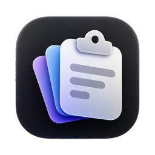
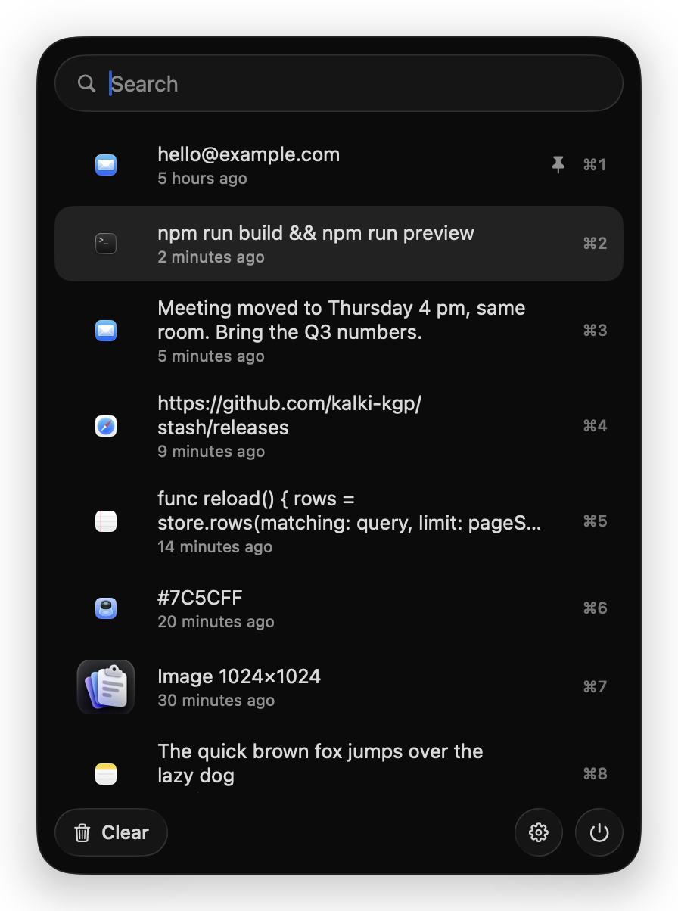
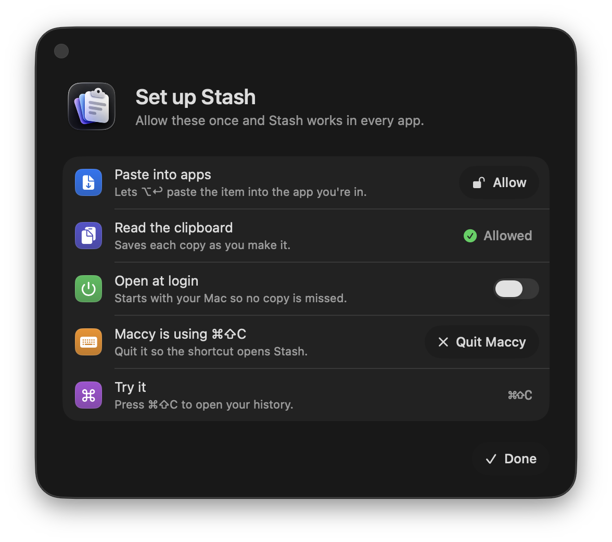

<div align="center">



# Stash

**Clipboard history for macOS that stays small.**

Everything you copy, one shortcut away. About 18 MB of memory, even with a long history.

[**Download the latest release**](https://github.com/kalki-kgp/stash/releases/latest)



</div>

## Why Stash

Clipboard managers tend to grow. They keep every screenshot as a raw bitmap and load the whole history into memory. Stash was built after Maccy reached 1 GB on a 1,000-item history.

Same history, two apps:

| | Maccy | Stash |
|---|---|---|
| Memory | ~1 GB | **~18 MB** |
| History on disk | 369 MB | **8.7 MB** |
| Open the panel (⌘⇧C) | | **~15 ms** |
| Search, per keystroke | | **~1 ms** |
| CPU while idle | | ~0% |

## Install

**Needs:** macOS 26 (Tahoe) or later. One download runs natively on both Apple silicon and Intel Macs.

1. Download `Stash-<version>.dmg` from [Releases](https://github.com/kalki-kgp/stash/releases/latest).
2. Open the DMG and drag **Stash** onto **Applications**.
3. Open Stash from Applications.

### The first time you open it

macOS shows **"Stash" Not Opened** ("Apple could not verify 'Stash' is free of malware…"). This is normal for apps downloaded outside the App Store. To open it:

1. Click **Done** on that message (not Move to Trash).
2. Open **System Settings → Privacy & Security**.
3. Scroll down to **Security**. You'll see *"Stash" was blocked to protect your Mac.* Click **Open Anyway**.
4. Click **Open Anyway** again in the dialog and enter your password or use Touch ID.

You only do this once. After that Stash opens like any other app.

<details>
<summary>Prefer Terminal?</summary>

This clears the download flag so macOS opens Stash without asking:

```sh
xattr -dr com.apple.quarantine /Applications/Stash.app
open /Applications/Stash.app
```

</details>

## First run

Stash lives in the menu bar. It has no Dock icon. On first launch it opens a setup window that walks through what macOS needs to allow:

<div align="center">

</div>

| Step | What it's for |
|---|---|
| **Paste into apps** | Lets ⌥↩ paste straight into the app you're working in. Click **Allow**, choose **Open System Settings** in the macOS prompt, and turn on **Stash** in the Accessibility list. |
| **Read the clipboard** | Saves each copy as you make it. If macOS asks whether Stash may paste from other apps, choose **Allow**. |
| **Open at login** | Starts Stash with your Mac so no copy is missed. |
| **Bring over your Maccy history** | Only appears if Maccy is installed. Click **Import**. macOS asks whether Stash may *access data from other apps*, because Maccy's history lives in Maccy's own folder. Choose **Allow**. Maccy's data is only read, never changed. |
| **Open Stash** | The shortcut, ⌘⇧C to start. Click it and press any combination with ⌘, ⌥ or ⌃ (F-keys work on their own) to change it. Combinations macOS already uses are turned down. |
| **Maccy is running** | Only appears while Maccy is running and the shortcut hasn't reached Stash yet, since Maccy keeps ⌘⇧C while it runs. **Quit Maccy** frees it, or record a different shortcut. |
| **Try it** | Press the shortcut. The row turns to *Works* once it reaches Stash. |

Each row updates as soon as you change the setting, so you can see when everything is ready. To open this window again, click the gear button at the bottom of the panel, press **⌘,** while the panel is open, or right-click the menu bar icon and choose **Settings…**

**Coming from Maccy?** Use the **Import** step in the setup window. Your pins, copy counts and pictures come along.

## Using it

Press **⌘⇧C** anywhere (or your own shortcut: open Settings, click the shortcut and press a new one). Start typing to search. Stash matches exact text first, then fuzzy matches (`stsh` finds `stash`).

| Keys | Action |
|---|---|
| ⌘⇧C | Open / close (change it in Settings) |
| ↩ · click · ⌘1–9 | Copy the item |
| ⌥↩ · ⌥-click · ⌥1–9 | Copy and paste into the current app |
| ⌥⇧↩ · ⌥⇧-click · ⌥⇧1–9 | Paste without formatting |
| ↑ ↓ | Move through the list |
| ⌥P | Pin / unpin (pinned items stay on top) |
| ⌥⌫ | Delete the item |
| ⌥⌘⌫ | Clear everything except pinned |
| ⇧⌥⌘⌫ | Clear everything |
| ⌘, | Settings |
| esc | Close |

Hover over an item for a moment to see its full text. Right-click an item to copy, paste, pin or delete it.

**Menu bar icon:** click to open the panel. ⌥-click to pause saving copies (click again to resume). ⌥⇧-click to skip only the next copy. Right-click for the menu.

Copies that password managers mark as private (1Password, KeePassXC and others) are never saved.

## Troubleshooting

<details>
<summary><b>"Stash is damaged and can't be opened"</b></summary>

Some browsers and download tools add a flag that macOS reports this way. The app isn't damaged. Run this in Terminal, then open Stash again:

```sh
xattr -dr com.apple.quarantine /Applications/Stash.app
```
</details>

<details>
<summary><b>Open Anyway doesn't appear in Privacy & Security</b></summary>

The button only shows for about an hour after you try to open the app. Open Stash from Applications again, then go straight back to **System Settings → Privacy & Security**. Or use the Terminal command above.
</details>

<details>
<summary><b>The shortcut (⌘⇧C) does nothing</b></summary>

Another app is using the shortcut. Maccy keeps ⌘⇧C whenever it's running. Quit the other app (Settings has a button for Maccy), or pick a different shortcut in Settings. To stop Maccy from coming back at login, remove it in **System Settings → General → Login Items**. You can always click the menu bar icon instead.
</details>

<details>
<summary><b>⌥↩ copies but doesn't paste</b></summary>

Stash needs Accessibility access to paste for you. Click the gear button in the panel (or right-click the menu bar icon → **Settings…**), then **Allow** next to *Paste into apps*, then turn Stash on in the list.

**After updating Stash**, macOS treats the new version as a different app, and the old switch stops working even though it still looks on. Stash detects this when it launches and opens the setup window. Click **Allow**, which clears the old entry first, and turn Stash on again. If the row still says *Still off* after you've turned it on, click **Try Again**.
</details>

<details>
<summary><b>Import says macOS didn't allow access</b></summary>

You chose *Don't Allow* when macOS asked whether Stash may access data from other apps. Click **Try Again** in the setup window. Stash clears that answer so macOS asks once more. This time choose **Allow**.
</details>

<details>
<summary><b>A pasted picture shows up as a file path</b></summary>

Some screenshot tools copy a picture together with a link to a temporary file. Stash keeps both, as the original copy did, and each app takes the format it understands. Text-only places, like a shell prompt, take the path. In Claude Code, paste pictures with **Ctrl+V**, which reads the picture itself.
</details>

<details>
<summary><b>I can't find the menu bar icon</b></summary>

On MacBooks with a notch, icons that don't fit are hidden behind the notch. Quit a few other menu bar apps, or hold ⌘ and drag icons to make room. ⌘⇧C works even when the icon is hidden.
</details>

<details>
<summary><b>Open at login doesn't stay on</b></summary>

macOS may want you to approve it. Open **System Settings → General → Login Items & Extensions** and turn on Stash under *Allow in the Background*. The setup window shows an **Approve** button when this is needed.
</details>

<details>
<summary><b>A copy didn't show up</b></summary>

Check whether the menu bar icon looks dimmed. If it does, saving is paused: ⌥-click it to resume. Copies from password managers are skipped on purpose. If macOS asked whether Stash may paste from other apps and you chose not to allow it, change it in **System Settings → Privacy & Security → Paste from Other Apps**.
</details>

## Privacy

Stash makes no network connections. Your history stays on your Mac in `~/Library/Application Support/Stash` and nowhere else.

## Uninstall

Quit Stash (right-click the menu bar icon → **Quit Stash**), then:

```sh
rm -rf /Applications/Stash.app ~/Library/Application\ Support/Stash
defaults delete dev.kalki.stash
tccutil reset Accessibility dev.kalki.stash
```

## How it stays small

- **Text** lives in SQLite with a trigram index, so search runs on disk instead of over a copy in memory.
- **Every useful format of a copy is kept** (text, formatting, file links, picture), so picking an item puts back what you copied and each app reads what it understands. Formatting (RTF, HTML) is compressed with LZFSE. Web archives and duplicate encodings of the same text aren't kept.
- **Images** are stored once per picture (named by a hash of their pixels) as HEIC, which is about 60× smaller than the TIFF macOS puts on the clipboard. The list shows small thumbnails.
- **Big images are decoded in a short-lived helper process.** Decoding a 26 MB screenshot leaves that much memory with the allocator for as long as the process runs. In a helper, it goes back to the system as soon as the helper exits.

## Build from source

Needs macOS 26 and the Command Line Tools (Xcode not required).

```sh
./build.sh                 # builds Stash.app
./test.sh                  # storage, search, capture, paste and import tests
Scripts/make-dmg.sh        # dist/Stash-<version>.dmg
```

`./build.sh` makes one universal app for Apple silicon and Intel; `ARCHS=arm64 ./build.sh` builds only one slice, for quicker local builds. On Apple silicon, `ARCH=x86_64 ./test.sh` runs the tests as Intel code through Rosetta.

`./build.sh test` adds a hook that `Tests/e2e/run.py` uses to drive the real app through the system clipboard.

## Credits

Keyboard shortcuts follow [Maccy](https://github.com/p0deje/Maccy).
